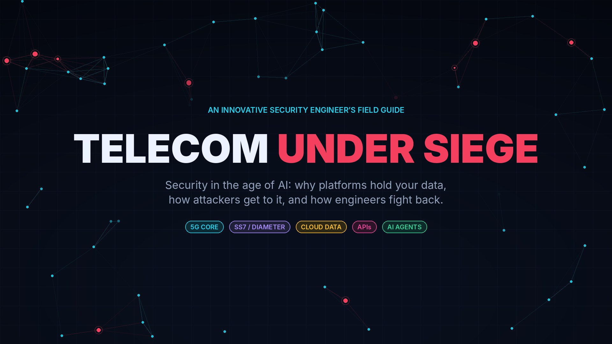
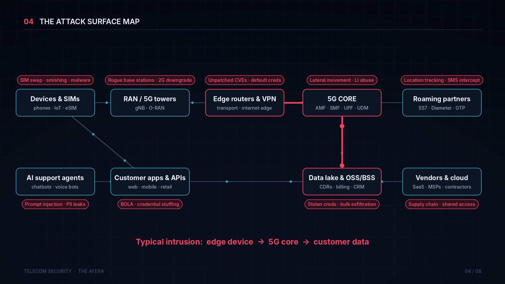
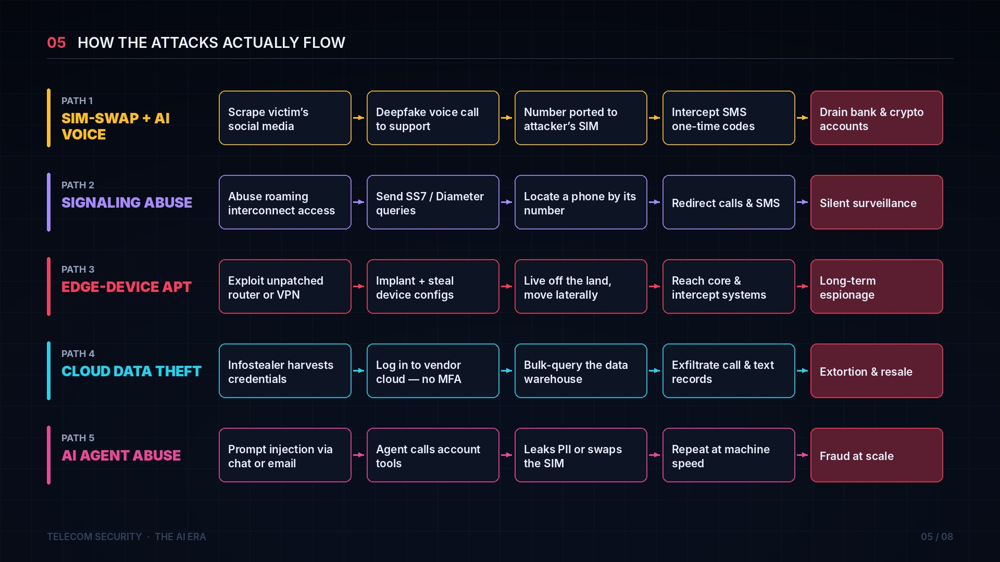
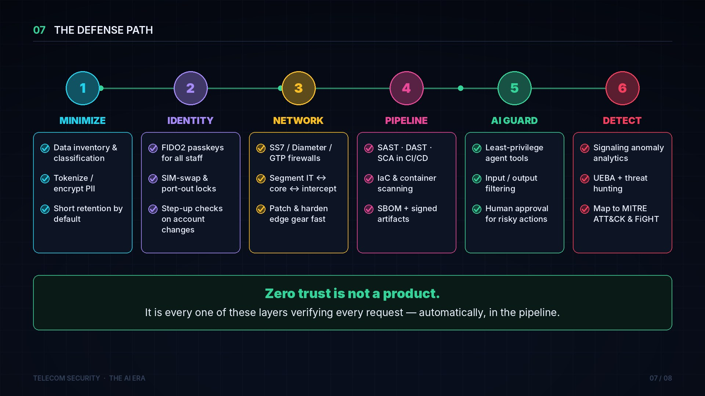

# Telecom Under Siege: Security in the AI Era

[](https://github.com/mail2ramya17/telecom-under-siege/actions/workflows/ci.yml)


A 2-minute animated explainer on how AI-era telecom platforms get attacked, why they hold so much
subscriber data, where that data leaks, and how security engineers defend it. The repo also holds
the working tools behind the story, one per language.



**Watch:** [`media/telecom-under-siege.mp4`](media/telecom-under-siege.mp4) (1080p, 1:52, cinematic soundtrack)
**Soundtracks:** [cinematic](media/soundtrack-cinematic.mp3) · [ambient](media/soundtrack-ambient.mp3) (original, royalty-free)

## The video

| # | Chapter | What it covers |
|---|---|---|
| 01 | The paradox | Smarter networks and better-skilled teams, yet bigger attacks: more data + connectivity + AI = bigger attack surface |
| 02 | This is not theoretical | T-Mobile 2021, AT&T 2024, Salt Typhoon 2024, SK Telecom 2025 |
| 03 | Why platforms collect your data | 8 data types held per subscriber and the 5 reasons carriers keep them |
| 04 | Attack surface map | Devices → RAN → edge → 5G core → data lake, plus roaming, APIs, AI agents, vendors |
| 05 | How the attacks flow | SIM-swap + AI voice, SS7/Diameter abuse, edge-device APT, cloud data theft, AI agent abuse |
| 06 | Where data gets exposed | 8 root causes, from over-collection to over-privileged AI |
| 07 | The defense path | Minimize → identity → network → pipeline → AI guard → detect |
| 08 | The toolkit | Recon, 5G labs, signaling, API, pipeline, cloud, detection, AI red teaming, frameworks |

| Attack surface | Attack paths | Defense path |
|---|---|---|
|  |  |  |

## What's in the repo

```
telecom-under-siege/
├── video/                  Python   – frame-by-frame renderer + two procedural soundtracks
├── explorer/               TypeScript – attack-path → control coverage analyzer (CI gate)
├── detector/               Java     – CDR bulk-exfiltration detector for warehouse audit logs
├── scripts/                Bash     – render pipeline, preflight, read-only host exposure audit
├── ansible/                Ansible  – render-host provisioning + Linux jump-host hardening
├── media/                  final MP4 and MP3 soundtracks
└── .github/workflows/      CI for every language
```

### Python: video and music (`video/`)

The whole video is drawn in code with Pillow and encoded with ffmpeg: no stock footage, no templates.
Both soundtracks are synthesized with NumPy/SciPy and timed to the chapter boundaries.

```bash
scripts/render.sh              # rebuild the video with the cinematic soundtrack -> build/
scripts/render.sh ambient      # or the ambient one
```

### TypeScript: attack-path explorer (`explorer/`)

Models the five attack paths from chapter 05 as kill chains (mapped to MITRE ATT&CK / ATLAS
techniques) and the six-layer defense path from chapter 07 as controls. It reports coverage gaps and
residual risk, and lets you ask "what if this control were missing?".

```bash
cd explorer && npm install && npm run build
node dist/cli.js                                     # Markdown coverage report
node dist/cli.js --disable net-sigfw,det-sig-analytics   # simulate no signaling firewall
node dist/cli.js --json --fail-under 60              # CI gate
```

### Java: CDR exfiltration detector (`detector/`)

Detects the "cloud data theft" path in a data warehouse query-audit log. It flags password-only sessions on
sensitive tables, new source IPs, row volumes far above a user's own baseline, and query bursts.
Exits `2` on high-severity findings so it can drive alerts or pipelines.

```bash
detector/build.sh                                    # runs against the synthetic sample log
detector/build.sh /path/to/your_query_log.csv
```

```
HIGH    NO_MFA_SENSITIVE  2026-03-12 22:01:30   vendor_bi    password-only session queried cdr_calls
HIGH    BULK_VOLUME       2026-03-12 22:01:30   vendor_bi    2,500,000 rows vs baseline median 1,854 (1348x)
...
Potentially exfiltrated by vendor_bi: 14,500,000 rows
```

The sample log is fully synthetic (RFC 5737 documentation IPs, invented users).

### Bash: automation (`scripts/`)

| Script | Purpose |
|---|---|
| `render.sh` | Parallel scene render → concat → soundtrack → loudness-normalized MP4 |
| `preflight.sh` | Verifies every toolchain this repo needs |
| `host-exposure-audit.sh` | Read-only audit of SSH config, exposed services, pending security patches, UID-0 accounts, world-writable files, auditd |

### Ansible: playbooks (`ansible/`)

| Playbook | Purpose |
|---|---|
| `render-host.yml` | Installs ffmpeg, Python libs, Node/TypeScript, JDK 21; clones and builds the repo |
| `harden-linux-host.yml` | Jump-host hardening: sshd lockdown (with a lock-out safety check), ufw, fail2ban, auditd rules, sysctl, automatic security updates, then runs the exposure audit to verify |

```bash
cd ansible
ansible-galaxy collection install -r requirements.yml
ansible-playbook playbooks/harden-linux-host.yml -l jump_hosts --check --diff   # dry run first
```

## Responsible use

Everything here is defensive. Run security tools only against systems you own or are explicitly
authorized to test. Incident summaries in the video are based on public company disclosures and
government statements.

## Contributors

- [@mail2ramya17](https://github.com/mail2ramya17): Ramya Kanderi, author
- [@kramya0920](https://github.com/kramya0920): contributor

Visuals, soundtrack and tooling built with the help of Claude (Anthropic).

## License

[MIT](LICENSE) © 2026 Ramya Kanderi
